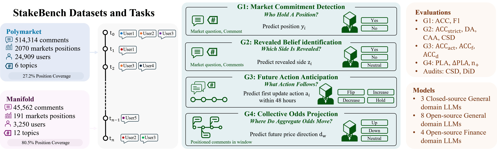

# StakeBench

Evaluation code for **StakeBench: Evaluating Language Understanding Grounded in Market Commitment** (NeurIPS 2026, Track on Evaluations and Datasets).

[Paper (arXiv)](https://arxiv.org/abs/2605.26074) · [OpenReview](https://openreview.net/forum?id=FWuX7Tx9gK) · [Dataset (Google Drive)](https://drive.google.com/drive/folders/1Xg83tRFH-BghesJUUGWY5XacQliCRYhu)



StakeBench links prediction-market comments from Polymarket and Manifold to each author's position, subsequent trading action and the market's odds, and evaluates language models on four progressive grounding tasks:

| Task | Question | Labels |
|---|---|---|
| G1 Market Commitment Detection | Who holds a position? | yes / no |
| G2 Revealed-Side Identification | Which side is revealed? | YES / NO / NEUTRAL |
| G3 Future Action Anticipation | What action follows within 48 h? | flip / increase / decrease / hold |
| G4 Collective Odds Projection | Where do aggregate odds move? | UP / DOWN / NEUTRAL |

The Drive folder holds the benchmark files (`polymarket/`, `manifold/`), the unmodified collection outputs (`raw/`) and the per-sample model outputs with prompt audit logs used in the paper (`model_outputs/`).

## Repository layout

```
config.py            paths, model list, task parameters
common.py            data loading, windowing, G1–G4 instance builders
prompt_factory.py    prompt templates for the four tasks (Appendix F)
parsing.py           output normalisation
model_profiles.py    model metadata (HF ids, backends, token limits)
llm_adapter.py       inference backends (transformers, OpenRouter)
pipeline_runners.py  per-task pipelines
runtime.py           config loading helper
run_local.py         entry point
run_hpc.sh           SLURM array job over the 12 open-weight models
analysis/            scripts behind Section 5.5 and the appendices
collection/          API collection and cleaning scripts for both platforms
fig/                 overview figure
```

## Setup

```bash
pip install -r requirements.txt
export COMMITBENCH_POLYMARKET_DIR=/path/to/StakeBench/polymarket
export COMMITBENCH_MANIFOLD_DIR=/path/to/StakeBench/manifold
export COMMITBENCH_OUT_DIR=/path/to/output
export HF_HOME=/path/to/hf_cache
```

## Running

```bash
# open-weight model on a local GPU
MODEL=qwen3:14b BACKEND=transformers python run_local.py

# closed model through OpenRouter
MODEL=claude-haiku-4.5 BACKEND=openrouter OPENROUTER_API_KEY=<key> python run_local.py

# SLURM: one model, or all 12 open-weight models as an array job
sbatch --export=MODEL=qwen3:14b run_hpc.sh
sbatch --array=0-11 run_hpc.sh
```

Models evaluated in the paper (`config.py`, `MODEL_ALL`): closed `gpt-5.5`, `gemini-2.5-flash`, `claude-haiku-4.5`; open-weight `qwen3:32b`, `qwen3:30b`, `qwen3:14b`, `qwen3:8b`, `gemma2:9b`, `deepseek:r1-8b`, `llama3.2:3b`, `mistral:7b`; finance-domain `finma-30b`, `fino1:14b`, `fino1:8b`, `finance-chat:7b`. All paper runs used the `transformers` backend for open-weight models and `openrouter` for closed ones.

## Output

`COMMITBENCH_OUT_DIR/<model>/<platform>/<topic>/` receives one CSV per task variant (`*_task0_0shot.csv`, `*_task0_1shot.csv`, `*_task1.csv`, `*_task1_did_pre.csv`, `*_task2*.csv`, `*_task3*.csv`; each row has the input text, gold label, prediction and `raw_response`), the audit files `commitment_validity_*.json` and `did_*.json`, `run_metadata_*.json`, and `llm_audit.jsonl` with every system prompt, user prompt and raw output as sent. `run_state.json` makes runs resumable. The outputs behind the paper are released in the dataset's `model_outputs/`.

Names in the code predate the paper: the internal name is CommitBench, the environment variables are `COMMITBENCH_*`, and task0–task3 correspond to G1–G4. Prompts are built by `prompt_factory.py`; the `prompt_task*` functions in `common.py` are legacy and not called.

## Analysis and collection

`analysis/` reproduces Section 5.5 and the appendices from the released model outputs (see `analysis/README.md`). `collection/` holds the scripts that collected and cleaned the data, in the order documented in the dataset's `data_processing.md` (see `collection/README.md`).

## License and citation

CC BY 4.0 (`LICENSE`).

```bibtex
@article{pei2026stakebench,
  title={StakeBench: Evaluating Language Understanding Grounded in Market Commitment},
  author={Pei, Yunhua and Hu, Jingyu and Shi, Yiwei and Ma, Hongnan and Liu, Weiru and Cartlidge, John},
  journal={arXiv preprint arXiv:2605.26074},
  year={2026}
}
```
